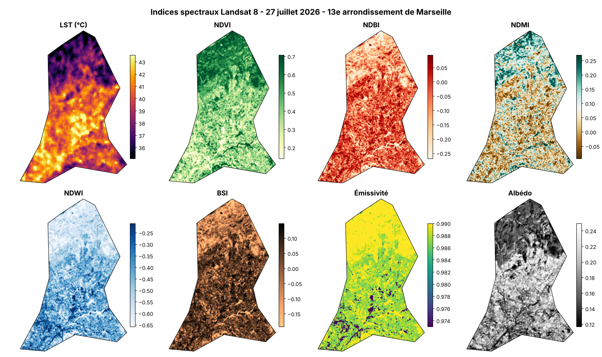
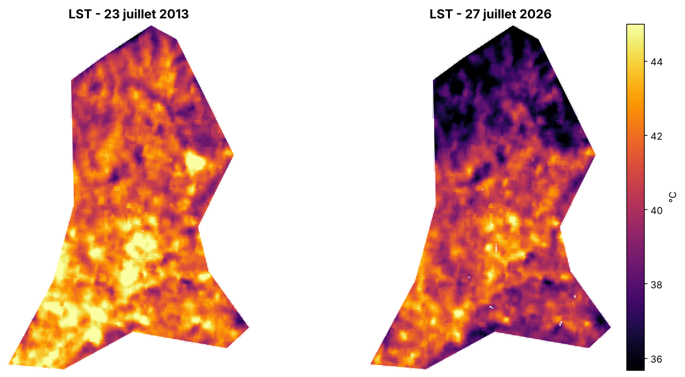
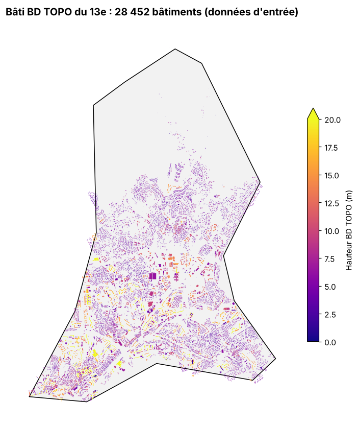

# Enrichissement du bâti par LiDAR HD et indices spectraux (Marseille 13e)

> Une chaîne FME qui ajoute à chaque bâtiment de la BD TOPO sa hauteur LiDAR HD et 8 indicateurs Landsat sur 4 dates, pour alimenter une modélisation de la performance énergétique.
> *FME workflow enriching 28,000 BD TOPO building footprints with LiDAR HD heights and Landsat 8 spectral statistics (LST, NDVI, NDBI, NDMI, NDWI, BSI, emissivity, albedo).*

**Master 2 Géomatique et modélisation spatiale (GMS)**, Aix-Marseille Université | 2026-2027
Cours *FME Workflow & Spectral Indices* | **Travail de groupe (groupe 3)** : A. Bakhoum, F. Omar, A. E. Soukou
**Projet en cours** : la partie LiDAR est terminée, l'intégration des indices et d'OSM dans FME est en cours.

---

## Objectif

Produire un fichier unique, `Enriched_Building.shp`, limité au **13e arrondissement de Marseille** (13013) et conforme au schéma BD TOPO BATIMENT. Chaque bâtiment y reçoit :

- sa **hauteur LiDAR** : `Z_MNS - Z_MNT` sur l'emprise, calculée **dans FME** ;
- les valeurs **min, moyenne et max** de 8 indices sur l'emprise, pour **4 dates** ;
- un **usage complété** par OpenStreetMap quand la BD TOPO est lacunaire.

## Données

| Donnée | Source | Détail |
|---|---|---|
| **BD TOPO BATIMENT** | IGN | 28 452 bâtiments dans le 13e |
| **LiDAR HD** (MNS, MNT et nuage de points LAZ) | IGN, Géoplateforme | 47 dalles de 1 km, résolution 50 cm |
| **Landsat 8 OLI/TIRS**, Collection 2 Level-2 | USGS, via Google Earth Engine | Trace 195/030, 4 scènes avec moins de 1 % de nuages |
| **OpenStreetMap** | Contributeurs OSM | Occupation du sol (landuse, amenity, leisure, natural) |

**Scènes Landsat retenues**

| Date imposée | Scène | Nuages |
|---|---|---|
| 23/07/2013 | LC08_195030_20130723 | 0,6 % |
| 30/12/2013 | LC08_195030_20131230 | 0,3 % |
| 29/11/2025 | LC08_195030_20251129 | 0,4 % |
| Été 2026 | LC08_195030_20260727 | 0,3 % |

Les 4 scènes ont le même capteur et la même trace, donc une géométrie d'acquisition homogène.

## Chaîne de traitement

1. Entrées : BD TOPO BATIMENT, LiDAR HD (MNS et MNT), indices Landsat, OSM
2. Dans FME : découpage sur le 13e, hauteur (MNS - MNT), statistiques zonales des indices, usage complété par OSM
3. Sortie : Enriched_Building.shp (EPSG:2154)

### 1. Téléchargement automatisé ([`scripts/00_telechargement_donnees_13e.py`](scripts/00_telechargement_donnees_13e.py))
- Emprise calculée depuis la limite du 13e, avec une marge de 100 m, en Lambert 93
- **LiDAR HD** : interrogation WFS du tableau d'assemblage IGN, téléchargement en flux avec reprise sur erreur
- **Landsat** : recherche STAC (Planetary Computer), lecture fenêtrée des COG pour ne télécharger que l'emprise
- **OSM** : extraction des polygones d'occupation du sol avec `osmnx`

### 2. Indices spectraux ([`scripts/01_indices_spectraux_landsat.py`](scripts/01_indices_spectraux_landsat.py))

| Indice | Formule (bandes OLI) |
|---|---|
| **LST** | `ST_B10 (K) - 273,15` (produit Surface Temperature L2) |
| **NDVI** | `(B5 - B4) / (B5 + B4)` |
| **NDBI** | `(B6 - B5) / (B6 + B5)` |
| **NDMI** | `(B5 - B6) / (B5 + B6)` |
| **NDWI** | `(B3 - B5) / (B3 + B5)` (McFeeters, 1996) |
| **BSI** | `((B6 + B4) - (B5 + B2)) / ((B6 + B4) + (B5 + B2))` |
| **Émissivité** | Seuils NDVI (Sobrino et al., 2004) |
| **Albédo** | `(0,356 B2 + 0,130 B4 + 0,373 B5 + 0,085 B6 + 0,072 B7 - 0,0018) / 1,016` (Liang, 2001) |

Prétraitements : facteurs d'échelle C2 L2, masque nuages et ombres (`QA_PIXEL`), puis **masque des réflectances aberrantes**, qui ramène le BSI de [-9,56 ; 2,30] à [-0,47 ; 0,55] et supprime les albédos négatifs.
Sortie : 4 GeoTIFF de 8 bandes nommées, en EPSG:2154 à 30 m, avec nodata = -9999 pour que FME ignore les pixels masqués.

### 3. Contrôle qualité (scène du 27/07/2026)

| Indice | Min | Max | Bornes attendues | Verdict |
|---|---|---|---|---|
| LST (°C) | 23,6 | 50,3 | 20 à 55 | OK |
| NDVI | -0,87 | 1,00 | -1 à 1 | OK |
| NDBI | -0,48 | 0,81 | -1 à 1 | OK |
| BSI | -0,47 | 0,55 | -1 à 1 | OK |
| Émissivité | 0,973 | 0,991 | 0,97 à 0,995 | OK |
| Albédo | 0,004 | 0,624 | 0 à 1 | OK |

### 4. Usage des bâtiments via OSM
[`donnees_reference/correspondance_osm_bdtopo.csv`](donnees_reference/correspondance_osm_bdtopo.csv) : une table de **117 correspondances** entre tags OSM et usages BD TOPO, avec un niveau de confiance pour chacune. Elle sert à compléter les usages manquants.

## Aperçu

| LST : été 2013 vs été 2026 | Bâti BD TOPO (données d'entrée) |
|---|---|
|  |  |

## Reproduire

1. Ouvrir les scripts dans **Google Colab** (cellules `# %%` dans l'ordre).
2. Placer la limite du 13e (`Arrondissement 13.gpkg`) dans `MyDrive/FME/`.
3. Pour les indices : disposer d'un compte **Google Earth Engine** et remplacer `PROJECT_ID` par son propre projet Cloud.

Les données brutes (LiDAR : plusieurs Go ; rasters) ne sont pas versionnées : les scripts les retéléchargent depuis les sources officielles.

## Outils

`FME` | `Google Earth Engine` | `Python` (GeoPandas, rasterio, pystac-client, osmnx) | `LiDAR HD IGN` | `Landsat 8`

## Contenu du dépôt

- `scripts/` : téléchargement des données, calcul des indices
- `donnees_reference/` : URL des 47 dalles LiDAR, scènes Landsat, table de correspondance OSM / BD TOPO
- `figures/` : indices, LST 2013/2026, bâti

---

**Auteur :** Ezechiel Agbewanou SOUKOU, géomaticien-urbaniste | [LinkedIn](https://www.linkedin.com/in/ezechiel-soukou) | [Autres projets](https://github.com/ezekielofficiel7-spec)
